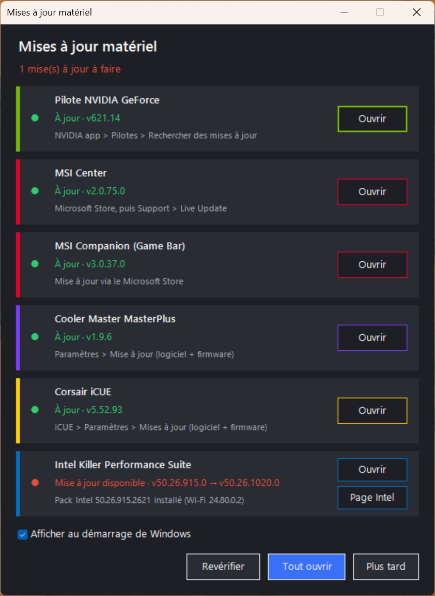

<div align="center">

# Pop-up mises à jour matériel

**Un coup d'œil pour savoir si les logiciels de votre matériel gaming sont à jour.**

[](#marques-prises-en-charge)
[](#marques-prises-en-charge)
[](#marques-prises-en-charge)
[](#marques-prises-en-charge)
[](#marques-prises-en-charge)

[](https://github.com/maythayus/popup-mises-a-jour/releases/latest)




</div>

Chaque carte affiche un indicateur :

- 🟢 **À jour** : la version installée est la dernière
- 🔴 **Mise à jour disponible** : avec la version installée → la nouvelle version
- 🟠 **Vérification impossible** : pas de connexion, application absente, etc.

Les vérifications ne font que lire : rien n'est téléchargé ni installé automatiquement. Le bouton **Ouvrir** lance l'application pour faire la mise à jour, **Revérifier** relance les contrôles, **Tout ouvrir** lance toutes les applications.

## Marques prises en charge

| Marque | Logiciel | Comment la dernière version est vérifiée |
|---|---|---|
|  | **Pilote GeForce** (via la NVIDIA app) | Service web officiel de NVIDIA (celui qu'utilise la NVIDIA app), pour votre carte exacte |
|  | **MSI Center** (Microsoft Store) | Catalogue public du Microsoft Store |
|  | **MSI Companion** (MSI Game Bar, Microsoft Store) | Catalogue public du Microsoft Store |
|  | **MasterPlus** | Page officielle masterplus.coolermaster.com |
|  | **iCUE 5** | Catalogue officiel winget (`Corsair.iCUE.5`), qui peut avoir quelques jours de retard sur Corsair |
|  | **Killer Performance Suite** (Microsoft Store) | Catalogue public du Microsoft Store pour le logiciel. La carte affiche aussi le pack Intel installé, reconnu au pilote Wi-Fi Killer. Les pilotes Wi-Fi/Ethernet se vérifient avec le bouton **Page Intel** (page officielle, toujours sur la dernière version), car Intel bloque la lecture par script |

## Utilisation

Téléchargez `MisesAJour.exe` depuis la [dernière version](https://github.com/maythayus/popup-mises-a-jour/releases/latest) et double-cliquez dessus. Depuis le code source, double-cliquez sur `MisesAJour.bat`.

Cochez **Afficher au démarrage de Windows** pour que le pop-up s'ouvre à chaque démarrage (un raccourci est créé dans le dossier Démarrage ; décochez pour le supprimer). Si le fichier est déplacé, décochez puis recochez la case.

L'exe n'est pas signé : si Windows SmartScreen affiche « Windows a protégé votre ordinateur », cliquez sur **Informations complémentaires** puis **Exécuter quand même**.

## Construire l'exe

`MisesAJour.exe` contient le script et le lance sans fenêtre de console. Pour le reconstruire après une modification de `MisesAJour.ps1` :

```powershell
powershell -ExecutionPolicy Bypass -File exe\Construire.ps1
```

Le script utilise le compilateur C# fourni avec Windows (.NET Framework 4), rien à installer.

## Chemins utilisés

- `C:\Program Files\NVIDIA Corporation\NVIDIA app\CEF\NVIDIA App.exe`
- MSI Center, MSI Companion et Intel Killer : détectés automatiquement via leur paquet Microsoft Store
- `C:\Program Files (x86)\CoolerMaster\MasterPlus\MasterPlusApp.exe`
- `C:\Program Files\Corsair\Corsair iCUE5 Software\iCUE.exe`

Pour changer un chemin, modifiez le tableau `$apps` en haut de `MisesAJour.ps1`.

## Prérequis

Windows 10/11 avec Windows PowerShell 5.1 (inclus dans Windows) et une connexion Internet pour les vérifications.

## Marques déposées

NVIDIA, GeForce, MSI, Cooler Master, MasterPlus, Corsair, iCUE, Intel et Killer sont des marques de leurs propriétaires respectifs. Ce projet est indépendant : il n'est ni affilié, ni approuvé, ni soutenu par ces sociétés. Les logos proviennent de [Simple Icons](https://simpleicons.org) et servent uniquement à identifier les logiciels pris en charge.
